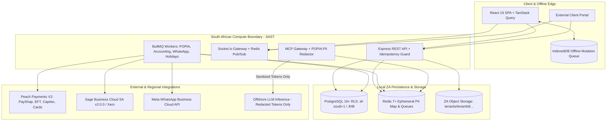

# Shogun Projects: South African Market Localization & Sovereignty Addendum (`SA_LOCALIZATION_SPEC.md`)

**Parent Specifications:** `CONTEXT.md`, `shogun_projects_system_specification.md`  
**Target Jurisdiction:** Republic of South Africa (`Africa/Johannesburg`, SAST / UTC+2)  
**Target Stack:** React 19, TypeScript (strict), Express, Prisma ORM, PostgreSQL 16+ (RLS + JSONB), Redis 7+ / BullMQ, Socket.io, MCP Gateway

---

## 1. Architectural Overview & Localization Topology

This addendum defines the mandatory regional extensions required to deploy **Shogun Projects** for South African enterprise, mid-market, and public-sector tenants while maintaining strict multi-tenant Row-Level Security (RLS) isolation.

