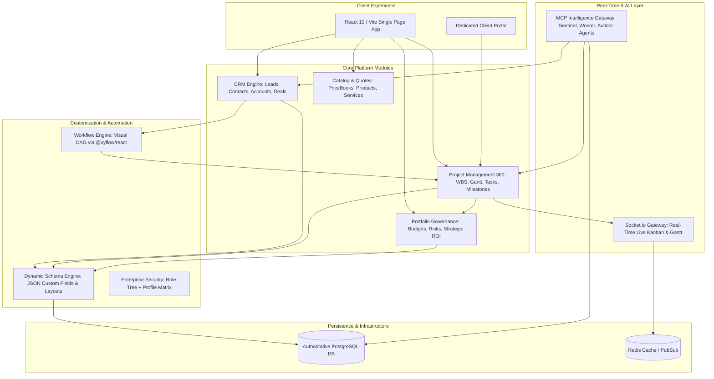

# Shogun Projects: Comprehensive System & Functional Blueprint

## 1. Executive Summary & Core Mission

**Shogun Projects** is a **Modular Multi-Tenant Enterprise Operations Suite** (modern open-architecture alternative to VTiger, Zoho One, and Salesforce) engineered with React 19, TypeScript, Express, Prisma, and PostgreSQL. It bridges the entire commercial-to-operational delivery lifecycle—from initial CRM lead qualification to quote generation, project delivery (WBS, Gantt, Milestones), portfolio governance (PPM), and client collaboration—with integrated multi-agent AI orchestration via the Model Context Protocol (MCP).

---

## 2. Architectural Pillars & Core Subsystems

---

## 3. Subsystem Functional Breakdown

### 3.1. Pluggable Module Architecture

Tenants can activate or deactivate modules per enterprise license or operational necessity, while maintaining zero data silos:

- **CRM Module**: [crmRoutes.tsx](file:///c:/Users/User/OneDrive/Desktop/Shogunate%20Solutions/Shogun%20Projects/src/routes/crmRoutes.tsx) & [crmRouter.js](file:///c:/Users/User/OneDrive/Desktop/Shogunate%20Solutions/Shogun%20Projects/server/src/routes/crmRoutes.ts)
  - Lead qualification, lifecycle stages, contact and account 360 firmographics.
  - Deals pipeline with automatic win conversion trigger.
- **Catalog & Quoting Module**: [catalogRoutes.tsx](file:///c:/Users/User/OneDrive/Desktop/Shogunate%20Solutions/Shogun%20Projects/src/routes/catalogRoutes.tsx) & [catalogRouter.js](file:///c:/Users/User/OneDrive/Desktop/Shogunate%20Solutions/Shogun%20Projects/server/src/routes/catalogRoutes.ts)
  - Multi-tier PriceBooks, hardware/service line items, discount margins.
  - Quote-to-project scope mapping.
- **Project Management (PM 360)**: [projectManagementRoutes.tsx](file:///c:/Users/User/OneDrive/Desktop/Shogunate%20Solutions/Shogun%20Projects/src/routes/projectManagementRoutes.tsx) & [projectManagementRouter.js](file:///c:/Users/User/OneDrive/Desktop/Shogunate%20Solutions/Shogun%20Projects/server/src/routes/projectManagementRoutes.ts)
  - Multi-level Work Breakdown Structure (WBS), finish-to-start Gantt timelines, interactive drag-and-drop Kanban boards.
  - Timesheets, milestone gates, project documents, and Markdown wikis.
- **Project Portfolio Management (PPM)**: [ppmRoutes.tsx](file:///c:/Users/User/OneDrive/Desktop/Shogunate%20Solutions/Shogun%20Projects/src/routes/ppmRoutes.tsx) & [ppmRouter.js](file:///c:/Users/User/OneDrive/Desktop/Shogunate%20Solutions/Shogun%20Projects/server/src/routes/ppmRoutes.ts)
  - Strategic corporate pillar alignment, cross-project budget rollups, CapEx/OpEx ceiling limits, 5x5 Probability-Impact risk register, and resource capability heatmaps.

---

### 3.2. Dynamic Schema & Layout Customization

- **Non-Destructive Schema Extension**: Administrators can add custom fields (Text, Picklist, Currency, Date, Relations) to standard modules ([projects](file:///c:/Users/User/OneDrive/Desktop/Shogunate%20Solutions/Shogun%20Projects/src/types/settings.ts#L17), [tasks](file:///c:/Users/User/OneDrive/Desktop/Shogunate%20Solutions/Shogun%20Projects/src/types/settings.ts#L17), [accounts](file:///c:/Users/User/OneDrive/Desktop/Shogunate%20Solutions/Shogun%20Projects/src/types/settings.ts#L17), [contacts](file:///c:/Users/User/OneDrive/Desktop/Shogunate%20Solutions/Shogun%20Projects/src/types/settings.ts#L17), [deals](file:///c:/Users/User/OneDrive/Desktop/Shogunate%20Solutions/Shogun%20Projects/src/types/settings.ts#L17)) without requiring schema migrations, persisting values inside PostgreSQL JSONB fields.
- **Dynamic Layout & Blocks**: Configurable multi-column blocks, collapsible sections, and sequence ordering rendered via dynamic field renderers.
- **Auto-Numbering Sequences**: Configurable tenant-wide prefix, padding, and incremental sequences for records (e.g. `PRJ-0001`, `DEAL-0042`).

---

### 3.3. Enterprise Security & Hierarchy (VTiger / Salesforce Model)

- **Profiles (Action & Field Privileges)**: Governs *what* an authenticated user can do. Configures granular Module-level CRUD (Create, Read, Edit, Delete) and Field-level access (Read-Only, Read-Write, Hidden).
- **Role Tree (Record Visibility)**: Governs *whose* records a user can see. Formed as a tree hierarchy where managers inherit visibility into records owned by their subordinates, while horizontal peer records remain strictly segregated unless explicitly shared.
- **Tenant Isolation**: Rigorous tenant foreign key enforcement ([tenantId](file:///c:/Users/User/OneDrive/Desktop/Shogunate%20Solutions/Shogun%20Projects/server/prisma/schema.prisma#L64)) across all Prisma queries, transactions, and WebSocket rooms.

---

### 3.4. Hybrid Agentic AI & MCP Integration

- **Model Context Protocol (MCP)**: Implemented in [crmTools.ts](file:///c:/Users/User/OneDrive/Desktop/Shogunate%20Solutions/Shogun%20Projects/server/src/mcp/crmTools.ts) and exposed via [mcpRoutes.ts](file:///c:/Users/User/OneDrive/Desktop/Shogunate%20Solutions/Shogun%20Projects/server/src/routes/mcpRoutes.ts).
- **Dual AI Role**:
  1. **Copilot / Sidecar Assistant**: Interactive intelligence aiding humans (extracting tasks from meeting notes, summarizing accounts, evaluating risk severity, drafting quotes).
  2. **Autonomous Assignable Agents**: First-class system actors (`Sentinel`, `Worker`, `Auditor`) capable of being assigned tasks or WBS nodes, executing automated checks, and updating task statuses.

---

### 3.5. Financial Scope & Cost/Margin Governance

- **Internal Financial Controls**: Strict tracking of internal labor costs, hourly timesheets, approved expense entries, CapEx vs. OpEx expenditures, and deliverable profit margins.
- **External Billing Decoupling**: Rather than building an in-house payment processor or general ledger, billing data and invoices are surfaced for client review or piped to dedicated accounting platforms (QuickBooks, Xero, Stripe) via webhooks and API endpoints.

---

### 3.6. External Stakeholder & Client Portal

- **Role-Scoped Client Experience**: External client stakeholders access a tailored, restricted view of the project.
- **Collaborative Governance**: Allows clients to monitor milestones, review deliverables, download authorized project documents, and submit [ClientChangeRequest](file:///c:/Users/User/OneDrive/Desktop/Shogunate%20Solutions/Shogun%20Projects/server/prisma/schema.prisma#L998) items with cost and schedule impact assessments.

---

### 3.7. Real-Time Collaboration & Synchronization

- **Authoritative Backend**: Express + Prisma + PostgreSQL serves as the definitive source of truth.
- **Live Collaboration Gateway**: [socket.ts](file:///c:/Users/User/OneDrive/Desktop/Shogunate%20Solutions/Shogun%20Projects/server/src/socket.ts) broadcasts `kanban:task_moved` and `gantt:task_rescheduled` across tenant-isolated project rooms with Redis pub/sub support for horizontal scale.
- **Snappy Client Experience**: React Query manages optimistic state updates, keeping UI views instantaneous and fluid during multi-user edits.

---

### 3.8. Deployment & Infrastructure Strategy

- **Dual-Target Hosting**:
  1. **cPanel / VPS Deployment**: Automated packaging via [package-cpanel.js](file:///c:/Users/User/OneDrive/Desktop/Shogunate%20Solutions/Shogun%20Projects/scripts/package-cpanel.js) with PM2 / Passenger execution and static frontend dist serving.
  2. **Containerized Cloud Native**: Docker / Cloud Run compatible with managed PostgreSQL and Redis instances.
